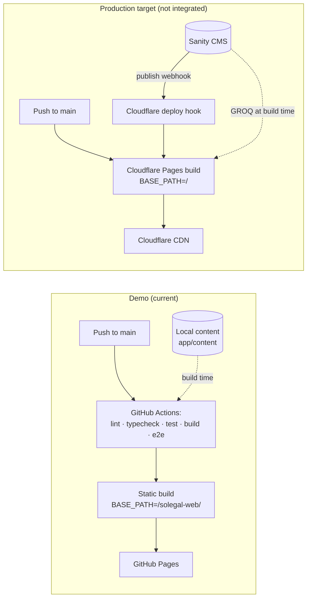

# Architecture

## Overview

solegal-web is a static, multilingual law-firm website. Every route in every locale is **prerendered to static HTML at build time**. No server or database runs at request time.

There are two deployment targets:

| | Demo (current) | Production (prepared, not integrated) |
|---|---|---|
| Hosting | GitHub Pages | Cloudflare Pages |
| Content | Local typed files in the repo | Sanity CMS |
| Base path | `/solegal-web/` | `/` |
| Deploy trigger | Push to `main` → GitHub Actions | Push to `main`, or Sanity publish → webhook → Cloudflare deploy hook |

Production integration is **out of current scope**. The architecture is shaped so that switching to it only means adding a content source implementation and deployment config, with no page rewrites.

## Stack

| Area | Choice | Rationale |
|---|---|---|
| UI | React 19 + TypeScript (strict) | Team familiarity, type safety |
| Framework / routing | React Router v8, framework mode | Uses Vite. With `ssr: false` + `prerender`, it outputs real HTML per route |
| Build tool | Vite | Fast dev server; Vitest shares its config |
| Styling | Tailwind CSS v4 (`@tailwindcss/vite`) | Consistent layouts; design tokens live in the theme |
| i18n | Custom, lightweight: locale route segment + typed dictionaries | Only 3 locales and static content; no runtime i18n library needed |
| Unit/component tests | Vitest + React Testing Library | Native to Vite |
| E2E tests | Playwright | Smoke tests run against the built static site |
| Lint / format | ESLint + Prettier | Standard |
| CI/CD | GitHub Actions → GitHub Pages | Free; fits the demo repo |

Exact versions are pinned during [01-project-setup](plans/01-project-setup.md).

### Why prerendering instead of a plain React SPA

A plain client-side SPA serves an empty HTML shell, and JavaScript builds each page in the browser. For a law-firm site that depends on search and link sharing, this is a weak fit:

- Crawlers and social previews (LinkedIn, Facebook, messengers) often don't run JS, so they see no title, description or content.
- Per-locale `<title>`, meta description, `hreflang` and Open Graph tags are much easier to get right when they are in the HTML.

React Router v8 prerendering keeps the React + TypeScript + Vite stack and emits static HTML for every route, so the site can be hosted on any static host.

## Directory structure (planned)

```
app/
  root.tsx                 # html shell, <html lang>, global styles
  routes.ts                # route config
  routes/
    _index.tsx             # "/" → redirect to /en/
    $lang._index.tsx       # one-page site (hero, about, team, contact), design variant A
    $lang.b.tsx            # same page, design variant B (until step 11)
    $lang.c.tsx            # same page, design variant C (until step 11)
  components/              # layout + UI components
  content/
    types.ts               # content types (mirror future Sanity schemas)
    en/ lv/ ru/            # local demo content
  lib/
    content/
      source.ts            # ContentSource interface
      local-source.ts      # implementation reading app/content/*
      index.ts             # selects the active source
    i18n/
      config.ts            # locales, default locale
      dictionaries/        # UI strings per locale
      use-t.ts
  styles/app.css           # Tailwind entry + theme tokens
public/
  _redirects  _headers     # Cloudflare Pages (ignored by GitHub Pages)
e2e/                       # Playwright specs
```

Route file names are illustrative. The final routing convention is decided in step 03.

## Routing and i18n

- Locales: `en` (default), `lv`, `ru`.
- Every page lives under a `:lang` segment: `/en/about`, `/lv/about`, `/ru/about`.
- `/` redirects to `/en/`.
  - On GitHub Pages this is done with a prerendered meta-refresh/JS redirect page.
  - On Cloudflare it is a real `302` in `_redirects`.
- An unknown `:lang` returns a 404.
- `<html lang>` is set from the route locale.
- UI strings (navigation, buttons, labels) live in typed dictionaries. A test checks that every locale has every key.
- The language switcher links to the same page in the other locale.

## Content access layer

Routes and components never import content files directly. They call a content source from route `loader`s:

```ts
interface ContentSource {
  getSiteSettings(locale: Locale): Promise<SiteSettings>;
  getTeam(locale: Locale): Promise<TeamMember[]>;
  getContactInfo(locale: Locale): Promise<ContactInfo>;
  getPartners(locale: Locale): Promise<Partner[]>; // step 08
}
```

- **Now:** `localSource` reads typed objects from `app/content/{en,lv,ru}/`.
- **Later:** `sanitySource` implements the same interface with GROQ queries. Because of `prerender`, loaders run **at build time**, so Sanity is queried only during the build and the deployed site stays fully static.
- The active source is selected in `app/lib/content/index.ts`, later via an env variable.
- Content types (`SiteSettings`, `TeamMember`, `ContactInfo`, `Partner`) are designed to map 1:1 to future Sanity document schemas. Their fields are listed in [design.md](design.md#content-fields-for-the-content-layer-and-the-future-sanity-schemas).

## Styling and design tokens

- Tailwind CSS v4 with theme tokens (colors, typography, spacing, radii) defined in `app/styles/app.css`.
- Components use token-based classes only; no ad-hoc hex values or font stacks.
- The brand palette, typography and look & feel come from [02-design-discussion](plans/02-design-discussion.md) and are documented in `docs/design.md`.

Token values (full rationale and contrast checks in [design.md](design.md)):

| Group | Tokens |
|---|---|
| Colors | `brand` #2D5703 · `brand-strong` #1F3D02 · `brand-soft` #3A6F05 · `tint` #F2F5EC · `surface` #FFFFFF · `surface-alt` #F7F8F4 · `ink` #111111 · `text` #2A2A2A · `muted` #5B5B5B · `line` #D9DCD3 · `on-brand` #FFFFFF · `on-brand-muted` #B9CFA0 · `photo-bg` #E3E8DA · `photo-fg` #C6D1B6 |
| Font | Montserrat 400/500/600/700, self-hosted via `@fontsource/montserrat` (latin, latin-ext, cyrillic) |
| Type scale | 12 · 13 · 15 · 16 (body) · 18 · 20 · 26–36 (h2) · 32–52 (h1) |
| Layout | container 1200px · section padding 96px / 64px mobile · Tailwind default spacing |
| Shape | radius 0 · no shadows · 1px `line` borders · 56×2px `brand` rule |

Light theme only. Until the customer picks a design (step 11), section components accept a `variant: "a" | "b" | "c"` prop; see [design.md](design.md#design-variants-pending-customer-choice).

## Testing strategy

| Layer | Tool | What |
|---|---|---|
| Unit | Vitest | i18n helpers, dictionary completeness, content source, utilities |
| Component | Vitest + RTL | Layout, navigation, language switcher, page sections |
| E2E smoke | Playwright | Built site: every route × locale renders, nav works, language switch works, no console errors |
| Static checks | `tsc --noEmit`, ESLint, Prettier | Run in CI on every push/PR |

## Build and deploy



Build output is a plain static folder (React Router's `build/client`). It can be deployed to either host without changes, apart from `BASE_PATH`.

## Environment configuration

| Variable | Used by | Demo | Production |
|---|---|---|---|
| `BASE_PATH` | Vite `base`, router `basename` | `/solegal-web/` | `/` |
| `CONTENT_SOURCE` | content layer selector | `local` | `sanity` (step 10) |
| `SANITY_PROJECT_ID` | sanitySource | — | step 10 |
| `SANITY_DATASET` | sanitySource | — | step 10 |
| `SANITY_API_TOKEN` | sanitySource (build-time only, secret) | — | step 10 |

All variables are listed in `.env.example`. Secrets never go into the repo.

## GitHub Pages constraints

- The site is served under a sub-path (`/solegal-web/`), so all URLs and assets must respect `BASE_PATH`.
- There are no server redirects or custom headers. The `/` → `/en/` redirect is a prerendered redirect page.
- Unknown URLs get `404.html`, which the build generates.
- `_redirects` and `_headers` in `public/` are ignored here and only take effect on Cloudflare.

## Open questions

- Custom domain for the demo and for production.
- Sanity localization strategy: document-level (one document per locale) or field-level (localized fields)?
- Where Sanity Studio lives: a folder in this repo, or a separate repo?
